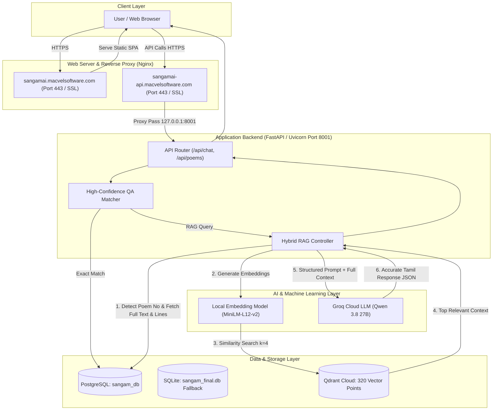

# 📜 சங்கமம் AI (Sangam AI - அறிக புறநானூறு)
## முழுமையான திட்ட விளக்க ஆவணம் & விளக்கக் கையேடு (Complete Project Documentation & Presentation Guide)

---

## 📌 1. திட்ட அறிமுகம் (Project Overview)

**Sangam AI (அறிக புறநானூறு)** என்பது 2000 ஆண்டுகள் பழமையான தமிழ் செவ்விலக்கியமான **புறநானூற்றுப் பாடல்களை** நவீன தலைமுறையினரும் மாணவர்களும் ஆராய்ச்சியாளர்களும் மிக எளிதாகப் படித்து, வரிக்கு வரி விளக்கம் பெற்று, AI மூலம் உரையாடிப் புரிந்துகொள்வதற்காக உருவாக்கப்பட்ட ஒரு **Production-Ready Hybrid RAG (Retrieval-Augmented Generation) அடிப்படையிலான AI தளம்** ஆகும்.

### 🌐 நேரலை இணையதள முகவரிகள் (Live Production URLs):
* **Frontend இணையதளம்**: [https://sangamai.macvelsoftware.com](https://sangamai.macvelsoftware.com)
* **Backend API தளம்**: [https://sangamai-api.macvelsoftware.com/api](https://sangamai-api.macvelsoftware.com/api)
* **API Documentation (Swagger UI)**: [https://sangamai-api.macvelsoftware.com/docs](https://sangamai-api.macvelsoftware.com/docs)

---

## 🏗️ 2. தொழில்நுட்பக் கட்டமைப்பு (Technology Stack)

| அடுக்கு (Layer) | தொழில்நுட்பம் (Technology) | பயன்பாடு (Purpose) |
| :--- | :--- | :--- |
| **Frontend** | **Angular 18** (Standalone Components) | நவீன, அதிவேக ஒற்றைப் பக்க பயனர் இடைமுகம் (SPA) |
| **Styling & UI** | **Tailwind CSS & Vanilla CSS** | Premium Dark Theme, Glassmorphism, Micro-animations |
| **Backend API** | **FastAPI** (Python 3.12) | Asynchronous, Type-safe RESTful API Framework |
| **Web Server / Proxy** | **Nginx & Uvicorn** | Reverse Proxy, SSL Termination, Load Balancing |
| **Relational & JSON DB** | **PostgreSQL** (`sangam_db`) / **SQLite** | பாடல்களின் மூல வரிகள், வரிக்கு வரி உரை, வரலாற்றுப் பின்னணி (SQLAlchemy ORM) |
| **Vector Database** | **Qdrant Cloud** (AWS Frankfurt Cluster) | 384-dimensional Embeddings சேமித்து Semantic Similarity Search செய்ய |
| **Embedding Model** | **Hugging Face** (`paraphrase-multilingual-MiniLM-L12-v2`) | தமிழ் மற்றும் ஆங்கில உரைக்கு 384 பரிமாண வெக்டார் உருவாக்கம் (100% இலவசம் & உள்ளூர் இயக்கம்) |
| **LLM Inference** | **Groq API** (`qwen/qwen3.8-27b`) | அதிவேக (Ultra-low latency), துல்லியமான தமிழ் இயற்கை மொழி பதில் உருவாக்கம் |
| **SSL & Security** | **Let's Encrypt Certbot** | முழுமையான End-to-End HTTPS பாதுகாப்பு |

---

## 🔄 3. முழுமையான அமைப்பு வரைபடம் (System Architecture)



---

## 🧠 4. Hybrid RAG இயங்கும் முறை (How Hybrid RAG Works)

பொதுவான AI மாடல்கள் (ChatGPT போன்றவை) சங்க இலக்கியப் பாடல்களுக்குத் தவறான தகவல்களை (Hallucination) அளிக்கும் அபாயம் உண்டு. இதைத் தடுக்க நாம் **Hybrid Retrieval Architecture**-ஐ உருவாக்கியுள்ளோம்:

```mermaid
sequenceDiagram
    autonumber
    actor User as பயனர் (User)
    participant Web as Angular Frontend
    participant API as FastAPI Backend
    participant PG as PostgreSQL (sangam_db)
    participant QD as Qdrant Vector DB
    participant LLM as Groq Qwen AI

    User->>Web: "101 song in 4 line meaning"
    Web->>API: POST /api/chat { "question": "101 song in 4 line meaning" }
    
    rect rgb(30, 41, 59)
    note right of API: நிலை 1: PostgreSQL நேரடி பாடல் வரி தேடல் (Structured DB Lookup)
    API->>PG: பாடல் எண் 101-ன் மூல வரிகள் & வரிக்கு வரி (Line 1 to 10) விளக்கம் எடுத்தல்
    PG-->>API: வரி 4: 'அணிபூ ணணிந்த யானை யியறேர்' -> பொருள்: அணிகலன் அணிந்த யானை...
    end

    rect rgb(15, 23, 42)
    note right of API: நிலை 2: Qdrant வெக்டார் தேடல் (Semantic Search)
    API->>QD: similarity_search("101 song in 4 line meaning", k=4)
    QD-->>API: தொடர்பான QA ஜோடிகள் மற்றும் பாடல் சாரம்
    end

    rect rgb(20, 30, 50)
    note right of API: நிலை 3: முழுமையான Context உடன் LLM உருவாக்கம்
    API->>LLM: Enhanced Prompt (அசல் வரிகள் + வரிக்கு வரி பொருள் + வெக்டார் சாரம்)
    LLM-->>API: துல்லியமான தமிழ் விளக்கம் (JSON Response)
    end

    API->>PG: தொடர்புடைய 4 வினாக்கள் (Smart Suggestions) எடுத்தல்
    API-->>Web: பதில் + மேற்கோள்கள் + தொடர்புடைய வினா பொத்தான்கள்
    Web-->>User: திரையில் அழகான தமிழ் உரை மற்றும் வினா பொத்தான்கள் காட்சிப்படுத்தல்
```



---

## 💻 5. முக்கிய செயல்தொகுதிகள் (Key System Modules)

### 1. முகப்பு பக்கம் (Interactive Dashboard)
* **அறிக புறநானூறு அறிமுகம்**: செவ்விலக்கியத்தின் சிறப்புகள், கடையெழு வள்ளல்கள், ஔவையார் பற்றிய தகவல்கள்.
* **Quick Navigation**: உடனடியாகப் பாடல்களை வாசிக்கவோ, AI-யிடம் பேசவோ வழிவகுக்கும் பட்டன்கள்.

### 2. புலவர்கள் களஞ்சியம் & தேடல் (Explore & Poets Directory)
* **150+ சங்க காலப் புலவர்கள் பட்டியல்**: கபிலர், ஔவையார், பரணர், நக்கீரர் உள்ளிட்ட புலவர்களின் பாடல்கள்.
* **Unicode எழுத்துப்பிழை திருத்தம்**: தமிழில் தட்டச்சு செய்யும்போது ஏற்படும் `ா்` மற்றும் `ர்` குழப்பங்களைத் தானாகவே சீர்செய்து துல்லியமாகத் தேடும் அல்காரிதம்.

### 3. ஊடாடும் பாடல் அரங்கம் (Course & Poem Detail Viewer)
* **வீடியோ விரிவுரை (Lecture Video)**: பாடலின் வரலாற்று விளக்கக் காணொளி.
* **வரிக்கு வரி பொருள் (Line-by-Line Meaning)**: பாடல் வரிகள் ஒவ்வொன்றும் பிரிக்கப்பட்டு தனித்தனி எளிய உரை.
* **திணை & துறை பகுப்பாய்வு**: புறநானூற்றுப் பாடலின் திணை (வெட்சி, கரந்தை, பாடாண்...) மற்றும் துறையின் இலக்கண விளக்கம்.

### 4. அறிவார்ந்த AI உரையாடல் தளம் (Interactive AI Chatbot)
* **பல்மொழி ஆதரவு (Tamil, English, Tanglish)**:
  - தமிழில்: *"புறநானூறு 101 பாடல் விளக்கம்"*
  - ஆங்கிலத்தில்: *"101 song in 4 line meaning"*
  - Tanglish-ல்: *"101 song oda meaning enna"*
  - அனைத்தையும் மிகச் சரியாகப் புரிந்துகொண்டு இயற்கையான தமிழில் பதிலளிக்கும்.
* **Smart Follow-up Suggestions**: கேள்விக்கு ஏற்ப அடுத்த 4 தொடர்புடைய வினாக்களைத் தானாகவே பரிந்துரைக்கும்.
* **Anti-Hallucination Guard**: இல்லாத தகவல்களுக்கு தானாகவே *"மன்னித்துக்கொள்ளுங்கள், புறநானூறு... பற்றிய தகவல்கள் நமது தரவுத்தளத்தில் பதிவேற்றப்படவில்லை"* என்று நேர்மையாகப் பதிலளிக்கும்.

---

## 🗄️ 6. தரவுத்தள கட்டமைப்பு (Database Schema)

### Table 1: `comprehensive_poems` (PostgreSQL / SQLite)
* `id` (INTEGER, Primary Key): தனித்துவ எண்.
* `poem_title` (VARCHAR, Unique): பாடலின் தலைப்பு (எ.கா: "புறநானூறு 101").
* `poem_number` (INTEGER, Indexed): புறநானூற்றுப் பாடல் எண்.
* `anthology_name` (VARCHAR): இலக்கியத் தொகுதி (Purananuru).
* `poet_name` (VARCHAR): இயற்றிய புலவரின் பெயர் (ஔவையார்).
* `basic_information` (JSONB): மூலப் பாடல் வரிகள், புலவர் பாலினம், குறிப்புகள்.
* `historical_information` (JSONB): வரலாற்றுப் பின்னணி, காலம், ஆண்ட மன்னன் (அதியமான்), இடம் (தகடூர்).
* `meaning_interpretation` (JSONB): எளிய உரை, விரிவான விளக்கம், ஆங்கில மொழிபெயர்ப்பு, மையக் கருத்து.
* `line_by_line_meaning` (JSONB): ஒவ்வொரு வரியின் தனித்தனி அர்த்தங்கள் (Array of split lines).
* `poem_structure` (JSONB): திணை, துறை, பா வகை.

### Table 2: `poem_qa` (PostgreSQL / SQLite)
* `id` (INTEGER, Primary Key): வினா ID.
* `poem_id` (INTEGER, Foreign Key): தொடர்புடைய பாடலின் ID.
* `original_id` (INTEGER): அசல் தரவுக் குறியீடு.
* `type` (VARCHAR): வினாவின் வகை (`factual`, `multi_hop`, `inferential`).
* `question` (VARCHAR, Indexed): தமிழ் வினா.
* `answer` (TEXT): விரிவான தமிழ் விடை.

---

## 🎤 7. Viva & Project Presentation-ல் விளக்குவது எப்படி? (5-Minute Speaking Script)

### 📌 நிமிடம் 1: அறிமுகம் (Introduction)
> *"அனைவருக்கும் வணக்கம். நான் உருவாக்கியுள்ள திட்டத்தின் பெயர் **Sangam AI (அறிக புறநானூறு)**. இது 2000 ஆண்டுகள் பழமையான தமிழ் செவ்விலக்கியமான புறநானூற்றை, நவீன **Artificial Intelligence, Hybrid RAG மற்றும் Vector Search** தொழில்நுட்பங்களைப் பயன்படுத்தி அனைவரும் எளிதாகப் படித்து ஆராயும் வகையில் உருவாக்கப்பட்ட ஒரு Full-Stack Web Application ஆகும். இந்த தளம் தற்போது **sangamai.macvelsoftware.com** என்ற இணையதளத்தில் நேரலையில் (Live) இயங்குகிறது."*

### 📌 நிமிடம் 2: சிக்கலும் அதற்கான தீர்வும் (Problem & Solution)
> *"சாதாரண ChatGPT போன்ற AI மாடல்களில் சங்க இலக்கியம் பற்றிக் கேட்கும்போது, அவை பாடல் வரிகள் தெரியாமல் இட்டுக்கட்டிய (Hallucinated) தவறான தகவல்களைத் தரும்.*  
> *இதனைத் தீர்க்க, நாங்கள் **Hybrid RAG (Retrieval-Augmented Generation)** முறையை உருவாக்கியுள்ளோம். இதில் அங்கீகரிக்கப்பட்ட பாடல் உரைகள் மற்றும் வரலாற்று ஆய்வுகள் **PostgreSQL** மற்றும் **Qdrant Vector Database**-ல் சேமிக்கப்பட்டுள்ளன. AI நமது உண்மையான தரவுத்தளத்தில் உள்ள சான்றுகளை மட்டுமே படித்துப் பார்த்துத் துல்லியமாகப் பதிலளிக்கும்."*

### 📌 நிமிடம் 3: தொழில்நுட்ப விளக்கம் (Technology Stack)
> *"இதன் தொழில்நுட்பக் கட்டமைப்பு:*
> 1. *Frontend-ல் **Angular 18** மற்றும் **Tailwind CSS** மூலம் Single Page Application-ஆக உருவாக்கப்பட்டுள்ளது.*
> 2. *Backend-ல் **FastAPI (Python)** மூலம் அதிவேகமான REST API கட்டமைக்கப்பட்டுள்ளது.*
> 3. *முக்கிய பாடல் தரவுகள் மற்றும் வரிக்கு வரி உரைகளுக்கு **PostgreSQL**-ஐயும், லோக்கல் டெவலப்மெண்டிற்கு **SQLite**-ஐயும் பயன்படுத்தியுள்ளோம்.*
> 4. *AI வெக்டர் தேடலுக்கு **Qdrant Cloud (AWS Frankfurt)** மற்றும் உள்ளூர் **Multilingual Sentence-Transformers** பயன்படுத்தப்பட்டுள்ளது.*
> 5. *மொழி உருவாக்கத்திற்கு **Groq Cloud (Qwen 3.8 LLM)** பயன்படுத்தப்பட்டுள்ளது."*

### 📌 நிமிடம் 4: நேரடி செயல்முறை விளக்கம் (Live Demo Flow)
> *"இப்போது நேரலைத் தளத்தைக் காண்பிக்கிறேன்:*
> 1. *Explore பக்கத்தில் 150-க்கும் மேற்பட்ட சங்க காலப் புலவர்களின் பட்டியல் உள்ளது. புலவர் பெயர் அல்லது பாடல் எண்ணைத் தேடலாம்.*
> 2. *Course Player-ல் பாடல் 101-ன் மூல வரிகள், வரிக்கு வரி பொருள், மற்றும் வரலாற்று பின்னணியை வாசிக்கலாம்.*
> 3. *AI Chatbot-ல் ஆங்கிலத்தில் **'101 song in 4 line meaning'** என்று கேட்கிறேன். உடனே AI மாடல் புறநானூறு 101-ன் 4-வது வரியான 'அணிபூண் அணிந்த யானை இயல்தேர்' என்பதன் பொருளைத் துல்லியமாகத் தருகிறது.*
> 4. *மேலும், அதனுடன் தொடர்புடைய அடுத்த 4 பரிந்துரை வினாக்களையும் (Follow-up Pills) தருகிறது."*

### 📌 நிமிடம் 5: எதிர்காலத் திட்டம் & முடிவுரை (Future Scope & Conclusion)
> *"எதிர்காலத்தில், சங்க இலக்கியப் பாடல்களுக்கான பிரத்யேக தமிழ் Voice Assistant வசதியையும், பள்ளி மாணவர்களுக்கான இலக்கிய வினாடி-வினா (Quiz) விளையாட்டையும் இணைக்க திட்டமிட்டுள்ளோம். நன்றி!"*

---

## ❓ 8. முக்கியமான Viva கேள்விகளும் பதில்களும் (Top Viva Questions & Answers)

#### Q1: RAG என்றால் என்ன? இந்த திட்டத்தில் Hybrid RAG ஏன் பயன்படுத்தினீர்கள்?
**விடை**: RAG என்பது **Retrieval-Augmented Generation** ஆகும். பயனர் கேட்கும் கேள்விக்கு முதலில் நமது தரவுத்தளத்திலிருந்து உண்மையான தகவலை மீட்டெடுத்து (Retrieve), பின் அதை வைத்து AI மாடல் விடையை உருவாக்கும் (Generate). 
வெறும் வெக்டர் தேடல் மட்டும் செய்தால் குறிப்பிட்ட வரி எண்கள் (எ.கா: வரி 4) விடுபடலாம். எனவே, **PostgreSQL-ல் உள்ள வரிக்கு வரி உரையையும்**, **Qdrant-ல் உள்ள வெக்டர் சாரத்தையும்** இணைத்து **Hybrid RAG** உருவாக்கியுள்ளோம்.

#### Q2: Vector Database எதற்குப் பயன்படுகிறது? SQL போதாதா?
**விடை**: SQL-ல் தேடும்போது வார்த்தைகள் சரியாகப் பொருந்தினால் மட்டுமே கிடைக்கும் (Exact keyword match). ஆனால் ஒரு பயனர் சொந்த நடையிலோ அல்லது மறைமுகமாகவோ கேள்வி கேட்டால் SQL-ல் விடை கிடைக்காது. **Qdrant Vector DB** மனித மொழியின் கருத்துப் பொருத்தத்தை (Semantic Meaning) 384-dimensional Cosine Similarity மூலம் கணக்கிட்டு, வார்த்தைகள் மாறினாலும் சரியான பதிலை மில்லி வினாடிகளில் தந்துவிடும்.

#### Q3: லோக்கலில் SQLite, சர்வரில் PostgreSQL எனப் பிரித்தது ஏன்?
**விடை**: லோக்கல் லேப்டாப்பில் மெமரி பயன்பாட்டைக் குறைத்து விரைவாக டெவலப் செய்ய இலகுவான **SQLite** சிறந்தது. ஆனால் நேரலை சர்வரில் (Production VPS) பல பயனர்கள் ஒரே நேரத்தில் தளத்தைப் பயன்படுத்தும்போது, அதிக வேகம், Concurrency மற்றும் JSON தரவுப் பாதுகாப்பிற்காக **PostgreSQL** தொழில்முறைத் தரமாக விளங்குகிறது.

#### Q4: உங்கள் AI இட்டுக்கட்டி தவறான தகவலை (Hallucination) தராது என்பதற்கு என்ன உத்தரவாதம்?
**விடை**: நாம் System Prompt-ல் தெளிவான வழிகாட்டுதல்களை அமைத்துள்ளோம். தரவுத்தளத்தில் விடை இல்லாத கேள்விகளுக்கு AI கற்பனையாகப் பதில் கூறாமல்:
*"மன்னித்துக்கொள்ளுங்கள், இந்த கேள்விக்கான தகவல்கள் நமது தரவுத்தளத்தில் பதிவேற்றப்படவில்லை"* என்று வெளிப்படையாக அறிவித்துவிடும்.

#### Q5: Groq API-ன் சிறப்பு என்ன?
**விடை**: Groq என்பது LPUs (Language Processing Units) மூலம் இயங்கும் உலகிலேயே அதிவேகமான AI Inference Engine ஆகும். இது வழக்கமான GPU-களை விட 5 முதல் 10 மடங்கு வேகமாக (வினாடிக்கு 300+ Tokens) தமிழ் பதில்களை உருவாக்குகிறது.

---

## 🚀 9. திட்டத்தை இயக்கும் கட்டளைகள் (How to Run)

### Local-ல் இயக்க:
```bash
# 1. Backend:
cd backend
.\venv\Scripts\activate
uvicorn main:app --reload --port 8001

# 2. Frontend:
cd frontend
npm start
# உலாவி முகவரி: http://localhost:4200
```

### VPS சர்வரில் இயக்க / பராமரிக்க:
```bash
# 1. புதிய மாற்றங்களைப் பெற:
cd /var/www/sangam-ai
git pull origin main

# 2. Frontend-ஐ Build செய்ய:
cd /var/www/sangam-ai/frontend && npx ng build

# 3. Backend-ஐ Restart செய்ய:
fuser -k 8001/tcp
cd /var/www/sangam-ai/backend
nohup ./venv/bin/uvicorn main:app --host 127.0.0.1 --port 8001 > uvicorn.log 2>&1 &
```
